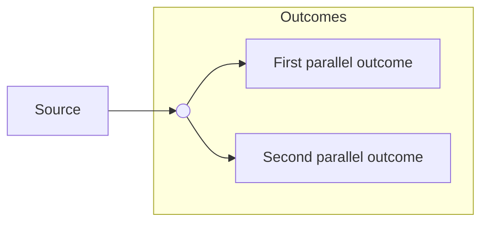

# mermaid

Named layout patterns, renderer rules, and the export pipeline. This
file is the catalog and the source of truth for pattern definitions.

## pi chat — go through the mermaid tool

In pi agent sessions, do not hand-author mermaid fences for chat
replies. Call the `mermaid` tool with a complete spec: diagram type,
every node label, every edge with its direction, the layout direction,
and the pattern name that fits (from the catalog below). The tool
writes the diagram with a nested model call, validates it with mmdflux,
retries on parse errors, and renders it in the transcript. The patterns
below are the source of truth for shape definitions; name the pattern
that fits in the spec you pass.

Hand-authoring stays for surfaces outside pi chat: SVG and PNG exports,
gruvbox ANSI terminal renders, documents, and files on disk.

## Named layout patterns

### junction — one node splits into parallel outcomes

Never fan multiple arrows directly out of one node. Run a single
shared arrow to an invisible junction, then split to each outcome.
Group the outcomes in a subgraph when they belong together.



`J((" "))` renders as a small unlabeled circle. Keep it unlabeled so
it reads as a split point, not a step.

### serpentine — a long ordered sequence as reading rows

First row left-to-right, down at the right edge, next row
right-to-left (boustrophedon). One subgraph per row, `direction LR`
for odd rows, `direction RL` for even rows, last node of each row
linked to the first node of the next.

```
flowchart TB
  subgraph row1["Row one"]
    direction LR
    A --> B --> C
  end
  subgraph row2["Row two"]
    direction RL
    D --> E --> F
  end
  C --> D
```

**KNOWN LIMITATION** (verified 2026-10-10, three workaround families
all failed): the cross-row connector routes between the subgraph
FRAMES (frame-center to frame-center), detached from the boxes. Failed
fixes: junction node between the rows; declaring the cross edge before
the subgraphs; removing subgraph titles. When a box-to-box connector
is required, use the wrap pattern or hand-author an SVG instead.

### wrap — serpentine fallback

Every row reads left-to-right; the last node of each row links down to
the first node of the next. Same subgraph structure, all rows
`direction LR`. The connector still routes frame-to-frame (same
limitation as serpentine), but the reading order stays natural.

### zones — ownership or phase grouping

Subgraph boxes named for who controls what (or when it happens);
arrows cross the zone borders. Best for operator and architecture
audiences, who think in ownership boundaries.

## Renderers

### pi chat — grok-mermaid

- The chat renders mermaid through grok-mermaid 0.2.3 (Unicode art).
- HARD RULE: if the rendered art is wider than the pane
  (`art.width > availableWidth`), the chat shows raw source. Test
  before sending:
  `node -e "import('.../grok-mermaid/dist/index.js').then(m => ...)"`
  from `~/.pi/agent/install/releases/<version>/node_modules/`.
- Fit the pane you are in, not a fixed number: a fullscreen pane is wide
  (170+ columns), so a wide diagram is correct there; a split pane is
  narrow. Render at the size the content needs — do not shrink for the
  sake of shrinking, and do not pad for the sake of width.
- In pi chat the `mermaid` tool does this for you: it resolves the chat's
  own grok-mermaid copy (from the pi managed install; `PI_MERMAID_GROK`
  overrides), trims the art to its smallest bounding box, and gates pane
  fit with zero warnings before displaying the transcript row.
- grok-mermaid IGNORES inner subgraph `direction` settings: a
  serpentine previews as vertically stacked groups. The PNG from
  mermaid.ink still shows the true layout — say so when previewing.
- Diagrams render best-effort: warnings do not block rendering, but a
  clean source has zero warnings.

### terminal — mmdflux ANSI

- Destination is a terminal pane, shell output, or a file the human
  will view with `cat`, `less -R`, or `bat`: render with mmdflux.
- `mmdflux -f text --color always` draws Unicode box art with 24-bit
  ANSI color. Use `-f ascii` when the surface cannot show Unicode
  (patches, CI logs, email). Default `--color auto` colors only a real
  tty and honors NO_COLOR; pass `always` for files and pipes.
- Color comes only from `classDef` styles — unstyled diagrams print
  plain. Style with the gruvbox catalog below so the art matches every
  surface in this setup: ghostty, tmux, and nvim all run
  gruvbox-material (medium background, mix foreground), and tmux
  passes truecolor through (`terminal-overrides ... RGB`).
- The escapes are truecolor (`48;2;r;g;b` / `38;2;r;g;b`): they bake
  exact RGB and do not depend on the terminal's 16-color palette, so
  the gruvbox hexes land the same on every surface.
- Fit the destination pane, same rule as pi chat — no fixed column cap.
  Strip the escapes before measuring, or the count includes them:
  `mmdflux ... | sed $'s/\x1b\\[[0-9;]*m//g' | wc -L`.
- Do not paste ANSI art into nvim buffers or pi chat: both show raw
  escape codes. pi chat stays grok-mermaid plain art via the mermaid
  tool.

#### gruvbox classDef catalog

```
classDef ok fill:#a9b665,color:#282828
classDef warn fill:#d8a657,color:#282828
classDef err fill:#ea6962,color:#282828
classDef info fill:#7daea3,color:#282828
classDef accent fill:#e78a4e,color:#282828
classDef special fill:#d3869b,color:#282828
classDef muted fill:#504945,color:#ebdbb2
```

- The hex values are the canonical gruvbox-material set from
  `tmux/.tmux.conf`; ghostty's palette carries the same values. Apply
  per node (`A[Ship]:::warn`) or per group (`class A,B err`). Use dark
  text `#282828` on the light fills and `#ebdbb2` on muted.
- Semantic mapping: ok = success, warn = caution, err = failure or
  danger, info = neutral detail, accent = attention, special =
  exceptional, muted = secondary or completed.

### mermaid.ink — PNG export

- URL: `https://mermaid.ink/img/<urlsafe-base64-of-source>?type=png`
  (or the `pako:` compressed form). Browser User-Agent required —
  plain urllib gets 403.
- `&width=N` scales the render proportionally (pure scaling, no
  re-layout). Set it AFTER the layout is final.
- `bgColor` bakes a background color. OMIT it for a transparent PNG.
- The server default theme is `default` (dark ink) — NOT a light ink.
  See ink variants below.

## Ink variants and surfaces

One transparent PNG cannot serve both dark and light backgrounds —
ink color decides legibility. Generate two variants when the
destination set is unknown:

- **dark ink** — `%%{init: {"theme": "default"}}%%`, no bgColor. For
  light surfaces: Google Docs pages, PDFs, GitHub.
- **light ink** — `%%{init: {"theme": "dark"}}%%`, no bgColor. For
  dark surfaces: Notion in dark mode. If dark-theme node fills swallow
  labels on the target background, use `theme=base` with explicit
  light `themeVariables` (primaryTextColor, lineColor) instead.

## Export rules

- Aspect ratio: width:height between 1:2 (0.5) and 3:1 (3.0); prefer
  16:9 (1.78) to 3:2 (1.5). Fix extremes by re-layout (direction,
  wrap, split), never by cutting content.
- Resolution: at least 250 DPI at the intended display size.
- Google Docs: `objectSize` unit is PT ONLY — the API rejects EMU
  (1pt = 1/72 inch; page text area 6.5 x 9 inches = 468 x 648 PT).
  The google_workspace MCP `insert_image` takes width/height in
  POINTS. One image request per batchUpdate call.
- Long-lived image URLs beat expiring upload slots: host PNGs on a
  server you control (e.g. the Caddy VPS pattern) rather than relying
  on render-on-fetch services or short-lived upload tokens.

## Verification workflow

1. Render the source through grok-mermaid; check width fits the pane
   and warnings are empty.
2. Render both ink variants through mermaid.ink; confirm valid PNGs.
3. Vision-check each PNG: labels verbatim, arrows and directions
   correct, subgraph boxes and dashed links correct, nothing clipped.
4. For ANSI destinations: render `mmdflux -f text --color always`,
   check the stripped width fits the pane (`sed $'s/\x1b\\[[0-9;]*m//g' |
   wc -L`), confirm the gruvbox escapes are present
   (`grep -q $'\x1b\[48;2'`), and check label contrast — dark `#282828`
   text on light fills, `#ebdbb2` on muted.
5. Pixel-check transparency (corner alpha 0) and composite each
   variant over its target background to confirm legibility.
