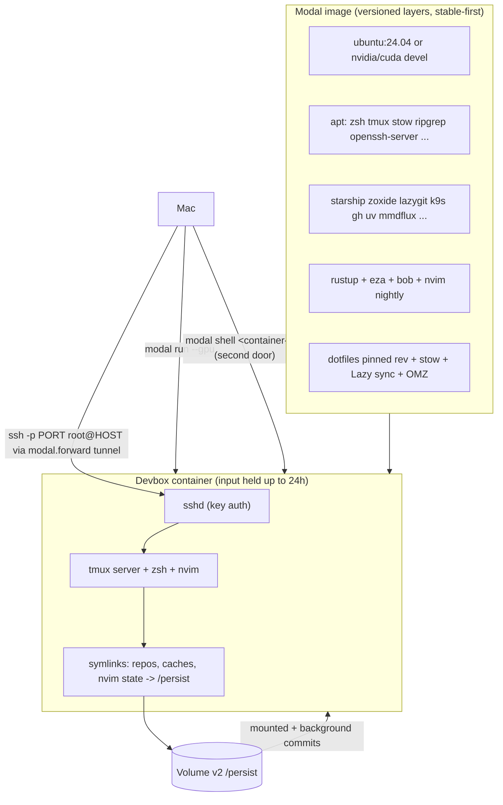

# Modal Devbox — plan

Run the dotfiles devbox identically on an ephemeral Modal worker, eventually
with GPU hosts and SSH access. Branch: `feat/modal-devbox`. Status:
phases 1–3 shipped on the Sandbox path (`ops/modal-devbox/`, runbook,
`scripts/test-modal-devbox.py`), including phase 2 secrets-sync
(`scripts/modal-secrets-sync` + `ops/modal-devbox/secrets-manifest.json`,
in-container materialization, verified 2026-10: env files at 0600,
`gh auth status` green in-container, oreilly MCP header resolves);
pending: phase 4 GPU/CUDA image, phase 4.5 snapshot workflow.

Research is complete and verified against current Modal docs
(`ops/modal-devbox/research-modal-images.md`, Oct 2026). Every decision below
cites it. Items still marked "verify empirically" are research-inferred and
get closed by the phase acceptance checks.

## Goal

- One command from the Mac drops into a zsh + tmux + Neovim environment that
  matches the AWS devbox (`ops/packer/`) and the homelab.
- The worker is ephemeral. Container filesystem state is disposable by design.
- Persistent state lives in a Modal Volume at `/persist`, never in the
  container.
- Nothing useful dies with a container: interactive installs are captured as
  image layers (codified) or Sandbox filesystem snapshots (frozen).
- A GPU variant hosts the full CUDA LSP experience from
  `docs/neovim-cuda-lsp.md`: the Mac cannot ship CUDA headers, the homelab
  can, and Modal GPU hosts match the homelab.
- SSH into the running container over a public TCP tunnel, with a tmux server
  inside whose sessions survive SSH disconnects.
- Every existing secret and MCP token reaches the devbox through a Modal
  Secret. No secret value ever enters the image, the volume, or this repo.

## Non-goals

- No always-on deployment. The devbox starts on demand and scales to zero.
- No macOS-only pieces on Modal: aerospace, ghostty config, launchd,
  terminal-browser cask, Brewfile.
- No herdr / pi agent harness inside the container (stretch goal, phase 5).
- No CI that talks to Modal. The offline suites must keep working with no
  Modal account, no network, and no `modal` binary.

## Research verdicts

The eight open questions, answered (details and citations in the report):

| Question | Verdict |
| --- | --- |
| docker-commit-style capture for `@app.function` containers | **No.** Codify interactive installs into new `run_commands` layers, or put state on the volume |
| Capture for Sandboxes | **Yes.** `Sandbox.snapshot_filesystem()` / `snapshot_directory()` produce a reusable `Image`; publish under a name. GPU Sandboxes are supported (`gpu=` on `Sandbox.create`, `runtime="gvisor"` only) and filesystem snapshots work with them; only experimental **memory** snapshots exclude GPUs |
| `modal proxy ssh` / `modal attach` / `modal interactive` | **Removed from the CLI.** SSH today = `sshd` in the image + `modal.forward(port=22, unencrypted=True)` |
| Keep-warm | A held input (function `timeout`, max 24 h) keeps the container alive regardless of `scaledown_window` (2 s – 20 min); re-invoke to renew |
| Volume pattern | `/persist` + `$HOME` symlinks is right. Volume **v2**: `sync` from inside, background commits every few seconds + final commit on shutdown, no file-count limit |
| Secrets sync | `modal secret create NAME --from-dotenv FILE --force` is idempotent; values are write-only (no read-back via CLI, API, or dashboard); value limit 32 KiB |
| GPU | `T4 L4 A10 L40S A100-40GB A100-80GB RTX-PRO-6000 H100 H200 B200 B300` (+`:n` counts, fallback lists); all functions are preemptible by default and `nonpreemptible=` is **unsupported for GPU**; `nvidia-smi` works with zero setup; toolkit comes from a `nvidia/cuda:*-devel-ubuntu24.04` base |
| Architecture | Images are **amd64-only** — no pinning needed; mmdflux (linux-x86_64) runs natively |

## Decisions

| Decision | Value | Why |
| --- | --- | --- |
| Container model | `modal.Sandbox` + `unencrypted_ports=[22]`, sshd baked in the image | User's pick: capture-ready (`snapshot_filesystem`), GPU-capable, and tunnel without holding a function input; `@app.function` + `modal.forward(22, unencrypted=True)` stays the documented alternative |
| CPU base image | `modal.Image.from_registry("ubuntu:24.04", add_python="3.12")` | Parity with the devbox AMI and the homelab; `debian_slim` is Debian |
| GPU base image | `nvidia/cuda:13.0.0-devel-ubuntu24.04` (plain `-devel`) | Host driver is 580.95.05+ / API 13.0; `-cudnn` adds GBs that make a cold box hydrate past the tunnel timeout, so it was rejected |
| Image layers | one layer per Packer phase, stable-first: apt → CLI tools → rust/bob/nvim → dotfiles/OMZ | Per-layer caching; changing the dotfiles layer only rebuilds the tail |
| Home | `$HOME=/root`, root user (verify empirically) | Modal containers run as root; stow targets `$HOME` so this is free |
| Volume | `modal.Volume.from_name("devbox-persist", create_if_missing=True, version=2)` at `/persist`, `$HOME` dirs symlinked in at container start | A mount over `$HOME` would shadow image-baked dotfiles; v2 handles nvim/cargo/node file counts |
| Dotfiles in image | build-time clone of a pinned revision, then stow + Lazy sync | Public repo needs no token; keeps the image self-contained; live checkouts live on the volume |
| SSH auth | public key only, from the `devbox-ssh` secret (`DEVBOX_SSH_PUBLIC_KEY`); never passwords | The unencrypted tunnel is public on the Internet; random port is not authentication |
| Secrets | `modal.Secret`, one per source env file; `scripts/modal-secrets-sync` is the only writer | Mirrors on-disk layout; rotation re-runs stay file-scoped |
| Image is code | changes go through layers + rebuild; the only sanctioned captures are new layers or Sandbox snapshots | There is no docker-commit for function containers |

## Parity baseline

`ops/packer/scripts/` is the canonical Ubuntu provisioning pipeline. The
Modal image must reach the same end state:

| Packer phase | Contents | Modal mechanism |
| --- | --- | --- |
| `install_system_packages.sh` | apt: git curl wget zsh tmux stow gcc make build-essential golang-go python3 python3-pip python3-venv nodejs npm fd-find ripgrep fzf tree luarocks unzip jq | `apt_install` layer on the Ubuntu base, **plus** `openssh-server` and `ca-certificates` (Modal SSH needs) |
| `install_cli_tools.sh` | starship, zoxide, lazygit, yq, kubectl, kubectx/kubens, k9s, awscli v2, uv, direnv, Claude Code, OpenCode, mmdflux (x86_64), grok-mermaid (npm -g), gh (devbox extra) | `run_commands` layer, mirroring the script commands, versions pinned |
| `install_rust.sh` | rustup, `cargo install eza bob-nvim`, `bob use nightly` | `run_commands` layer |
| `deploy_dotfiles.sh` | clone dotfiles, remove stock rc files, stow zsh/tmux/nvim/starship, terminfo, `nvim --headless "+Lazy! sync"` | `run_commands` layer (use the real nvim binary path, not the bob proxy — same caveat as Packer) |
| `install_shell_plugins.sh` | Oh My Zsh `--unattended`, zsh-autosuggestions, zsh-syntax-highlighting (TPM self-bootstraps) | `run_commands` layer |
| `cleanup.sh` | stow git config, `chsh zsh`, apt clean | `SHELL=/bin/zsh` env + tmux `default-shell zsh`; no `chsh` on root |
| `create_user.sh` | user `aviralmansingka` | skipped: Modal runs root |

Parity rule for the suite: the Modal apt set must be a superset of the Packer
set, and the extra entries must be exactly the allowlist (`openssh-server`,
`ca-certificates`). Anything else is drift.

## Target architecture

- `ops/modal-devbox/devbox.py` defines the image (two bases sharing the
  non-base layers), the volume, and one `devbox` function. GPU is a parameter
  (None, T4, L4, H100 — allowlisted) via `devbox.with_options(gpu=...)`.
- The function links `$HOME` into `/persist`, writes `authorized_keys` from
  the secret, starts sshd, opens `modal.forward(port=22, unencrypted=True)`,
  prints the `ssh -p PORT root@HOST` line, and holds its input in a sleep loop
  (`timeout=24*60*60`) with periodic `persist.commit()`.
- Second door into the same container: `modal shell <container-id>` /
  `modal container exec` (debug shell; terminates with the container).
- Teardown: `modal container stop <id>` — final volume commit runs, state
  stays on the volume, next `modal run` restores `$HOME` via symlinks.

## Volume layout

Baked into the image — change means rebuild, which is the deploy:

- apt packages, rustup + cargo tools, bob + nvim nightly, all CLI tools
- dotfiles clone (pinned revision) + stow + terminfo + Lazy sync
- Oh My Zsh + zsh plugins

On the volume at `/persist` — survives container death (`entrypoint.sh`
links these on every boot; first boot seeds each from the image):

- `~/.local/share/nvim` → `nvim-share` — lazy.nvim plugins + Mason tools
- `~/.local/state/nvim` → `nvim-state` — shada, undo
- `~/.local/share/bob` → `nvim-bob` — Neovim installs + bob's `used`
  marker, so `bob use <version>` survives sandbox death (the entrypoint
  repoints the `nvim` shim to bob's proxy)
- `~/.cache` → `cache` — cargo, uv, pip caches
- `~/repos` → `repos` — work checkouts (dotfiles itself clones per build)
- `~/vault` → `vault` — obsidian.nvim's expected vault dir
- `~/.zsh_history` → `zsh_history`

tmux state is deliberately not persistent: sessions live only while the
container runs. Volume commits are background (every few seconds) plus a
final commit at shutdown; from inside an SSH session, `sync /persist` flushes
on demand (v2). Preemption or a killed container still loses only the running
tmux session — `/persist` keeps everything else.

## Secrets and MCP tokens

`scripts/modal-secrets-sync` reads the live secret locations on the Mac and
pushes them to Modal. The committed manifest (`ops/modal-devbox/secrets-manifest.json`)
records secret names, source paths, and variable names — never values. Sync
command per entry: `modal secret create NAME --from-dotenv FILE --force`
(idempotent overwrite; `--allow-missing` on delete cleanup).

Inventory (key names only; values live on the Mac):

| Source (Mac) | Variables | Modal Secret | Used on devbox |
| --- | --- | --- | --- |
| `~/.env` | DD_API_KEY, DD_APP_KEY, HYPERBOLIC_API_KEY, OREILLY_TOKEN | `devbox-env` | shell, oreilly MCP |
| `~/.config/pi-browserbase.env` | BROWSERBASE_API_KEY, BROWSERBASE_PROJECT_ID | `devbox-mcp-browserbase` | browserbase MCP |
| `~/.config/pi-google-workspace.env` | GOOGLE_OAUTH_CLIENT_ID/SECRET/REDIRECT_URI, OAUTHLIB_INSECURE_TRANSPORT, WORKSPACE_MCP_CREDENTIALS_DIR | `devbox-mcp-google` | google workspace MCP |
| `~/.config/pi-telegram.env` | PI_TELEGRAM_BOT_TOKEN, PI_TELEGRAM_ALLOWED_CHATS, PI_TELEGRAM_PREFIX, PI_TELEGRAM_CWD, PI_TELEGRAM_PROCESS_EXISTING | `devbox-telegram` | daemon testing only; nothing auto-runs |
| `~/.config/pi-whatsapp.env` | PI_WHATSAPP_ALLOWED_CHATS, PI_WHATSAPP_PREFIX, PI_WHATSAPP_API_BASE | `devbox-whatsapp` | daemon testing only |
| `~/.config/pi-stt-client.env` | PI_STT_ENDPOINT, PI_STT_TOKEN | `devbox-stt-client` | STT client pointing at the homelab worker |
| `~/.pi/agent/auth.json` | fireworks API key; anthropic/openai/openai-codex OAuth (base64, must fit the 32 KiB value limit) | `devbox-pi-auth` | pi in-container (phase 5) |
| `gh auth token` | GH_TOKEN | `devbox-gh` | gh, gh-dash, git push over HTTPS |
| `~/.ssh/id_ed25519.pub` | DEVBOX_SSH_PUBLIC_KEY | `devbox-ssh` | `authorized_keys` in the container |
| `~/.aws/credentials` | AWS access keys | `devbox-aws` (opt-in flag) | awscli when needed; terraform stays on the Mac |

Materialization at container start keeps parity with the Mac:

- The devbox function takes all manifest secrets and writes them back as env
  files — `/root/.env` and `/root/.config/pi-*.env`, mode 0600 — so
  `mcp.json` shell refs like `!. ~/.env; echo "Bearer $OREILLY_TOKEN"` resolve
  identically to the Mac. The sync script normalizes `export VAR=...` lines.
- `GH_TOKEN` lands in the environment; `gh auth status` passes, gh-dash works.
- `DEVBOX_SSH_PUBLIC_KEY` becomes `/root/.ssh/authorized_keys` (append, 0600).
- `auth.json` travels base64-encoded and is decoded at start into
  `/root/.pi/agent/auth.json` (phase 5 only).
- Notion MCP OAuth state is an open item: copy the local MCP auth state or
  redo OAuth in-container (resolve in phase 5).

Security model (per research):

- Secret values are **write-only**: no read-back through CLI, API, or
  dashboard; audit events record names only (audit logs are Enterprise-only).
- The real exposure: anyone who can run a container in the workspace can read
  every secret from the container environment. This stays a personal
  workspace; never a shared one.
- Warm containers keep old values after rotation. After re-running the sync:
  `modal container stop <id>`, then `modal run` again.
- Manifest, plan, and runbook carry names and paths only. Values never enter
  the repo, the image, logs, or the volume.
- The sync script prints secret names and variable names, never values;
  `--dry-run` shows the plan without touching Modal.
- The offline CI suite lints the manifest against fixture files; it never
  reads real `~/.config` or `~/.env` files.

## Phases

### Phase 0 — research (done)

`ops/modal-devbox/research-modal-images.md` answers all eight question groups
with current-API citations.

### Phase 1 — CPU devbox parity (shipped, verified 2026-10)

`devbox.py` with the full layer stack; `modal run` builds and boots the
devbox in seconds once cached. Verified in the smoke run: every CLI tool
from `install_cli_tools.sh` (plus gh) on `PATH`, nvim v0.13.0-dev nightly,
stowed configs active, `$HOME=/root`, root login shell zsh, the full mason
toolset (`MASON_TOOLS`, suite-checked against mason.lua) installed at build
so first opens are clean, apt parity suite green, build logs via
`modal image logs`.

### Phase 2 — volume persistence (shipped, verified) + secrets (shipped, verified 2026-10)

Volume v2 at `/persist` + first-boot symlink bootstrap in `entrypoint.sh`.
Verified: a marker under `/persist` survived two full sandbox deaths,
`sync /persist` works from inside a session, image rebuilds leave the
volume untouched. Secrets: `scripts/modal-secrets-sync` + manifest upload
one Modal Secret per Mac source (`--from-json` payloads, `--force`
idempotent, `--dry-run`/`--only`/`--aws`); the launcher probes which
manifest secrets exist and mounts only those (fresh workspaces still
boot), with the ephemeral per-launch SSH-key secret applied last.
`entrypoint.sh` materializes values back to disk (`~/.env`,
`~/.config/pi-*.env` at 0600, base64 files decoded at their targets,
`GH_TOKEN`/`GITHUB_TOKEN` via a guarded `~/.zshenv` include — all
container-local, never on `/persist`). Verified in-container: env files
0600, `gh auth status` green, non-empty `GH_TOKEN`, oreilly MCP header
resolves from `~/.env`. Rotation: re-sync + `devbox stop` (warm containers
keep old values).

### Phase 3 — SSH + warm container (shipped, verified)

sshd + `unencrypted_ports=[22]` tunnel on the Sandbox. Verified: key-only
SSH from the Mac, a detached tmux session alive across SSH disconnects,
sequential second connections landing in the same container, teardown via
`modal container stop <id> -y` with the launcher exiting cleanly. The
sandbox lives out its lease (max 24 h); re-run to renew.

### Phase 4 — GPU + CUDA (shipped, verified)

GPU variant on `nvidia/cuda:13.0.0-devel-ubuntu24.04`, sharing the same
`_build_image` layer chain as the CPU variant. Verified on a T4:
`nvcc` 13.0 compiles a `__nv_bfloat16` + `cudaMalloc` sample, `nvidia-smi`
works with zero setup, and `clangd --check` reports "All checks completed,
0 errors" with `--cuda-path` + libdevice resolved through
`scripts/cuda-compile-db` — the bar `docs/neovim-cuda-lsp.md` sets and the
Mac cannot meet. Two findings baked into the design: the `-cudnn-devel`
base is too large to hydrate before the tunnel timeout (plain `-devel` is
used), and symlinking `nvcc` into `/usr/local/bin` breaks its
argv[0]-relative header lookup (image `PATH`/`CUDA_HOME` env instead).

### Phase 4.5 — Snapshot capture (shipped, verified)

`devbox snapshot [name]` freezes the running sandbox's container filesystem
into a published named image (`snapshot_filesystem()` + `publish`). Verified:
a marker file written interactively at `/opt/probe/tool.txt` was present in a
brand-new sandbox created from the snapshot image. Mounted volumes are not
captured (by design — `/persist` already persists), and a snapshot copies the
filesystem, not processes.

### Phase 5 — stretch: agent harness in-container

pi + extensions + skills inside the container, driven over SSH, with
`devbox-pi-auth` decoded at start. Out of scope until phases 1–4 land.

## Remaining gaps to verify empirically

1. `$HOME == /root` — closed (phase 1 smoke).
2. Volume mount shadowing — closed operationally: the bootstrap never mounts
   over `$HOME`, and first-boot seeding worked.
3. Two SSH sessions in one container — closed (phase 3 smoke: tmux survived
   disconnect/reconnect through the same tunnel).
4. Warm-container secret rotation — live now that the phase 2 secrets sync
   has landed: values freeze at container start, so rotate = re-sync +
   `devbox stop` (documented in the runbook).
5. `run_commands` build-step timeout is undocumented — keep the dotfiles layer
   lean; use `run_function` (1 h default, configurable) if a phase outgrows it.
6. Snapshot image as a `@app.function` image (phase 4.5) — unverified.

## Repo changes (implementation checklist)

- `ops/modal-devbox/devbox.py` — image layers, volume, devbox function
- `ops/modal-devbox/secrets-manifest.json` — names, source paths, variable
  names; never values
- `scripts/modal-secrets-sync` — the only writer of Modal Secrets; reads live
  Mac locations, `--dry-run` supported
- `ops/modal-devbox/README.md` — runbook: build, run, ssh, teardown, volume
  management, secrets sync + rotation, GPU tiers + prices, preemption caveat,
  Sandbox capture workflow
- `ops/modal-devbox/.gitignore` — `__pycache__/`
- `scripts/test-modal-devbox.py` — offline suite, `# Paths:`
  `ops/modal-devbox/**`, `scripts/modal-secrets-sync`, plus itself; checks:
  apt superset + exact extras allowlist vs the Packer script, every
  `run_commands` layer carries a phase comment, GPU allowlist enforced,
  manifest lint (no values, names match known variable patterns, fixture
  files only)
- `docs/ci-tests/modal-devbox.md` — suite doc with `/simple` variant
- Root `README.md` — "Option C: Modal devbox"
- `AGENTS.md` — Modal devbox invariants (see below)

`nm-lint.sh` already `py_compile`s every tracked Python file, so `devbox.py`
gets syntax coverage for free; the suite adds the structural parity checks.

## AGENTS.md invariants (to add when implementation lands)

- The Modal image is code: changes go through `run_commands` layers and a
  rebuild. The only sanctioned captures are new layers or Sandbox filesystem
  snapshots; never rely on a mutated running container.
- The volume at `/persist` is the only mutable state. The container filesystem
  is disposable; a preempted or stopped devbox loses only tmux.
- `scripts/modal-secrets-sync` is the only writer of Modal Secrets. Secret
  values never enter the repo, the image, or the volume; the manifest and
  docs carry names and paths only. Personal workspace only — anyone who can
  run a container can read every secret from its environment.
- GPU usage is budget-conscious: T4/L4 for interactive LSP work; H100-class
  only for real compute. GPU functions are preemptible by default and cannot
  be made nonpreemptible.
- CI stays offline: no Modal account, network, or `modal` binary in any
  `scripts/test-*` suite.
