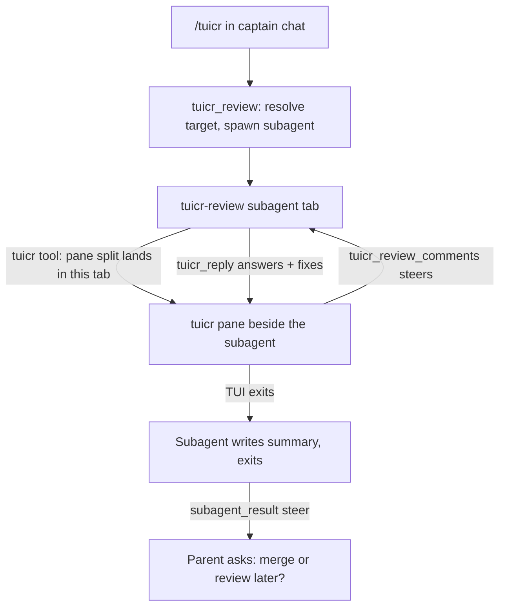

# tuicr extension

Interactive code review through [tuicr](https://github.com/aviralmansingka/tuicr)
for pi sessions running inside a multiplexer (Herdr, tmux, Zellij, cmux).

## The review flow (preferred)

`/tuicr` opens a review with the **tuicr-review subagent**. One command, two
surfaces: the subagent's tab hosts the agent and — once it launches it — the
tuicr TUI pane beside it.

```text
/tuicr                     the session repo's open PR (see below), else its working tree
/tuicr open                same, explicit
/tuicr pr 272              GitHub PR 272 of the session repo
/tuicr open pr 272         same, explicit
/tuicr -r main..HEAD       a commit range
/tuicr open -w ~/some/repo working tree of another checkout
```



How it works:

1. `tuicr_review` (the tool behind `/tuicr`) resolves the requested target,
   refuses a duplicate reviewer for the SAME target, and spawns the
   `tuicr-review` agent (via `interactive-subagents`) in a new tab. The
   parent opens no pane and starts no watcher — the call returns immediately
   and does not carry the session slug.
2. The subagent launches the review pane itself with the internal `tuicr`
   tool. The wrapper it spawns inherits the subagent's `HERDR_PANE_ID`, so
   the split lands in the subagent's own tab, beside the agent. The same
   tool call starts the subagent's comment watcher; the pane and the watcher
   live and die with the subagent's session. When the task names an
   already-active session, the subagent attaches with `sessionSlug` +
   `attachOnly` instead of launching a second pane.
3. Comments written before the watcher attached never steer in, so the
   subagent sweeps them right after attaching (bash `tuicr review comments`)
   and answers them like any others. Every later user comment steers into
   the subagent; it answers inside the TUI with `tuicr_reply` and applies
   fixes for actionable comments.
4. When the human closes the TUI, the watcher steers the final notice, the
   subagent writes a summary of every comment and fix, and its session exits
   — the summary steers back to the parent, which asks the user whether to
   merge or review later. If the tuicr CLI keeps failing instead, the watcher
   still steers a final notice so the subagent summarizes and exits rather
   than hanging.

### Target resolution

The requested target is always honored — a review never silently attaches to
an unrelated active session:

- explicit `sessionSlug` → attach to exactly that session;
- explicit PR → attach only to an active session whose slug ends with
  `/pr/<N>`; if none matches, launch a new pane for that PR;
- explicit revset → launch a new pane for the range;
- explicit working tree → launch a new pane with `-w`;
- no target given → the current worktree's open PR (`git branch
  --show-current`, then `gh pr list --head <branch> --state open`): exactly
  one → that PR (match-or-launch as above); none → working-tree review;
  several → error listing them, asking for `pr` explicitly.

The same rules apply to the subagent's own `tuicr` tool call and to the
watcher's session resolution: with a PR target, several active sessions are
disambiguated by the `/pr/<N>` slug suffix instead of erroring, and a non-PR
launch attaches to the session that appeared after it — never to one that was
already active.

### Concurrency

The parent chat never answers review comments while a subagent runs for that
repo; a same-repo chat watcher is stopped on launch so comments are not
double-steered. One reviewer per review TARGET: re-running `/tuicr` for a
target whose review is still open is refused with guidance, while different
targets (another PR, another range, another worktree) run concurrently, each
in its own tab with its own pane and a deterministic subagent name
(`tuicr-review-pr-272`, `tuicr-review-rev-…`, `tuicr-review-wt-…`).

## Tools

| Tool | Audience | Description |
| --- | --- | --- |
| `tuicr_review` | captain | Resolve a target and spawn the tuicr-review subagent, which opens the pane in its own tab. The preferred route. |
| `tuicr` | internal | Launch the review pane in THIS session's tab and attach the comment watcher, or attach to an active session matching the target; `attachOnly` never opens a pane. Used by the tuicr-review subagent. |
| `tuicr_reply` | any watcher host | Post a reply inside the TUI, anchored to a file/line or comment id. |

`/tuicr watch …` runs the internal chat-watcher mode directly (comments steer
into the captain chat instead of a subagent) and `/tuicr stop` stops it. This
mode exists for debugging and for sessions without `interactive-subagents`.

## Environment

| Variable | Default | Purpose |
| --- | --- | --- |
| `TUICR_BG_POLL_MS` | `15000` | Comment poll interval |
| `TUICR_BG_COALESCE_MS` | `30000` | Batch coalescing window |
| `TUICR_BG_LAUNCH_WAIT_MS` | `25000` | Slug resolution wait after launch |
| `TUICR_SKILL_DIR` | `~/.agents/skills/tuicr` | Where the multiplexer wrapper scripts live |
