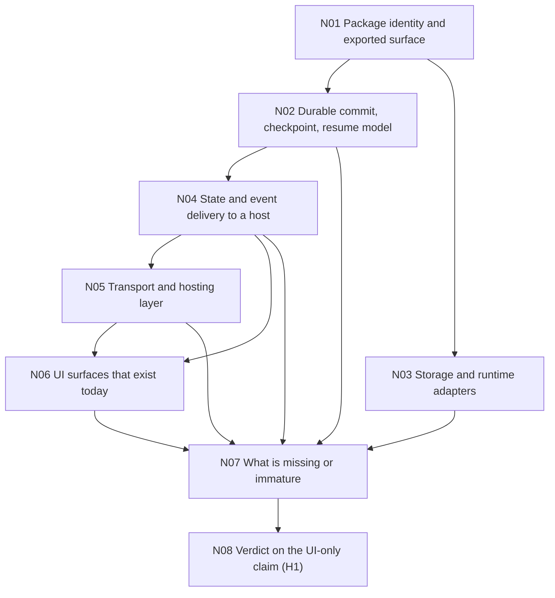

# pi-durable: durable runtime, host event flow, and the "UI-only" claim

**Research question.** What is `@earendil-works/pi-durable`, how does its durable runtime
work, and how do host harnesses receive and show its events?

**Hypothesis under test (H1).** "The only thing pi-durable is missing is a UI for the
harness to display the events."

**Run date.** 2026-11-26. **Package under study.** `@earendil-works/pi-durable@1.6.1`
(published 2026-11-25). **Audience.** A developer deciding whether to build on pi-durable,
and whether a UI is the remaining work.

**Scope.** The npm package surface and behaviour, the durable execution model, storage and
runtime adapters, the state/event channels a host can consume, transport and hosting,
existing UI surfaces, and evidence of what is absent or immature. **Exclusions.** Model
quality, pi-ai provider behaviour, pricing, and any non-pi agent runtime.

## Node map

## Node table

| ID | Question | Depends on | Acceptance condition | Child | State |
| --- | --- | --- | --- | --- | --- |
| N01 | What is pi-durable 1.6.1, what does it export, and where does it sit among the pi packages? | — | Export/subpath table with evidence, dependency map, release timeline, and an explicit list of peer packages it does and does not depend on | n01-pkg-surface-durable | done |
| N02 | How do commits, checkpoints, and resume actually work, and what makes state durable? | N01 | Mechanism with file and line evidence, one crash-resume walk-through, and the failure limits named | n02-durable-model-durable | planned |
| N03 | Which storage and runtime adapters ship, and which are absent? | N01 | Adapter matrix with conformance evidence, plus named missing adapters and runtimes | n03-adapters-durable | planned |
| N04 | What channels carry runtime progress to a host, in what shape, and what replaced the removed event stream? | N01, N02 | Channel inventory with signatures and payload shapes, the "render state, not events" decision, and its consequences for a renderer | n04-event-flow-durable | planned |
| N05 | Does pi-durable ship a wire protocol, server, or RPC for a remote UI? | N04 | Explicit yes/no with evidence, and a list of what a remote UI must build itself | n05-transport-durable | planned |
| N06 | Which UI surfaces exist today, on which versions, and are any wired to pi-durable 1.6.x? | N04, N05 | Table of surfaces with repo link, package version, consumed shape, and last activity | n06-ui-surfaces-durable | planned |
| N07 | What is actually absent or immature, beyond rendering? | N02, N03, N04, N05, N06 | Evidence-backed gap list with severity and a source for each gap | n07-gaps-durable | planned |
| N08 | Does the evidence support H1? | N07 | Explicit verdict (supported, partly, refuted) with the reasoning that follows from the briefs | n08-verdict-durable | planned |

## Lessons

Lessons follow in dependency order after the briefs are accepted.
