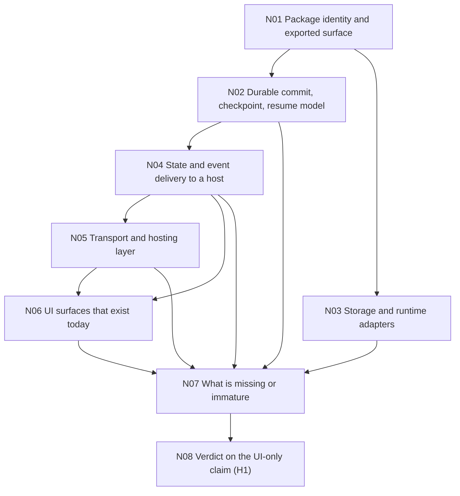

# pi-durable: durable runtime, host event flow, and the "UI-only" claim

**Research question.** What is `@earendil-works/pi-durable`, how does its durable runtime
work, and how do host harnesses receive and show its events?

**Hypothesis under test (H1).** "The only thing pi-durable is missing is a UI for the
harness to display the events."

**Run date.** 2026-11-26. **Package under study.** `@earendil-works/pi-durable@1.6.1`
(published 2026-11-25). **Audience.** A developer deciding whether to build on pi-durable,
and whether a UI is the remaining work.

**Scope.** The npm package surface and behaviour, the durable execution model, storage and
runtime adapters, the state/event channels a host can consume, transport and hosting,
existing UI surfaces, and evidence of what is absent or immature. **Exclusions.** Model
quality, pi-ai provider behaviour, pricing, and any non-pi agent runtime.

## Node map

## Node table

| ID | Question | Depends on | Acceptance condition | Child | State |
| --- | --- | --- | --- | --- | --- |
| N01 | What is pi-durable 1.6.1, what does it export, and where does it sit among the pi packages? | — | Export/subpath table with evidence, dependency map, release timeline, and an explicit list of peer packages it does and does not depend on | n01-pkg-surface-durable | done |
| N02 | How do commits, checkpoints, and resume actually work, and what makes state durable? | N01 | Mechanism with file and line evidence, one crash-resume walk-through, and the failure limits named | n02-durable-model-durable | done |
| N03 | Which storage and runtime adapters ship, and which are absent? | N01 | Adapter matrix with conformance evidence, plus named missing adapters and runtimes | n03-adapters-durable | done |
| N04 | What channels carry runtime progress to a host, in what shape, and what replaced the removed event stream? | N01, N02 | Channel inventory with signatures and payload shapes, the "render state, not events" decision, and its consequences for a renderer | n04-event-flow-durable | done |
| N05 | Does pi-durable ship a wire protocol, server, or RPC for a remote UI? | N04 | Explicit yes/no with evidence, and a list of what a remote UI must build itself | n05-transport-durable | done |
| N06 | Which UI surfaces exist today, on which versions, and are any wired to pi-durable 1.6.x? | N04, N05 | Table of surfaces with repo link, package version, consumed shape, and last activity | n06-ui-surfaces-durable | done |
| N07 | What is actually absent or immature, beyond rendering? | N02, N03, N04, N05, N06 | Evidence-backed gap list with severity and a source for each gap | n07-gaps-durable | done |
| N08 | Does the evidence support H1? | N07 | Explicit verdict (supported, partly, refuted) with the reasoning that follows from the briefs | n08-verdict-durable | done |

## Artifacts

- `nodes/N01.md` to `nodes/N08.md` hold the full evidence briefs.
- `nodes/CONTEXT.md` holds the shared facts and the rules given to the researchers.
- `src/pi-durable/` holds the extracted npm tarball used for every package claim.

## Headline

The claim is **partly** true. pi-durable 1.6.1 gives a host a complete, typed, JSON-safe
conversation state, and no first-party renderer for 1.6.x exists as a package. But the state is
**not** an event stream: version 1.5.0 removed the event API and made the committed view the
only channel. And a renderer is not the last gap. Transport, user identity, a 1.6.1-clean SQL
backend, and backup with deletion all remain after a UI. Nine gaps rank above the renderer.
For a local single-user host, the missing renderer is the main gap. For a hosted or serverless
host, it is not.

## Lessons

## N01: The package surface and where it sits

`@earendil-works/pi-durable@1.6.1` is a runtime library. It is not an application.
It gives a host a durable agent harness. It renders nothing.

**Terms.** A *subpath export* is one entry in `package.json#exports`. A *peer package* is a
package that the host installs next to this one. A *monorepo* holds many packages in one Git
repository.

**Result.** The package publishes 20 export entries. They are the root, `./env` and
`./env/node`, `./codemode`, `./tool-search`, `./tools`, four `./images` entries, eight storage
entries, `./testing`, and `./package.json`.
The root exports `Harness`, `createRegistry`, `defineTask`, `defineExtension`, `defineTool`,
`createSession`, and `ConversationTranscript`. Ten types carry the model: Harness, Session,
Conversation, Entry, Document, Task, Submission, Extension, Registry, and Agent.

**Mechanism.** The package builds on five pinned siblings: `chord`, `pi-ai`, `pi-codemode`,
`pi-schema`, and `pi-telemetry`. Chord supplies the store, the delta operations, and the
watch types. `pi-ai` supplies models, messages, and tool schemas.
The package does **not** depend on `pi-agent-core`, `pi-coding-agent`, `pi-tui`, or
`pi-web-ui`. It is therefore a peer of the agent core, not a layer above it.
A host must supply storage, an execution environment, model providers, transport, and UI.

**Example.** The vendor's own `apps/p2` imports `createRegistry` and
`createToolSearchExtension`. The pi CLI imports the package nowhere, and not even as a
development dependency. Among published packages, only `@earendil-works/pi-env` depends on
it at runtime.

**Maturity.** npm holds 22 versions in 67 days, from 0.0.1 to 1.6.1. The CHANGELOG has eight
breaking-change sections and 67 breaking bullets. The README opens with "**Experimental.**
The API changes without notice between releases." The 1.0 launch post already shows APIs
that version 1.5.0 removed.

**Limits.** The tarball holds `dist/` only. The monorepo holds `src/` and a 409 KB spec.
A `dist` line number runs 10 to 50 lines below its `src` counterpart.

Next, N02 explains what the runtime makes durable.
Evidence: [`nodes/N01.md`](nodes/N01.md), `README.md:3`, `CHANGELOG.md:5-124`.

## N02: What makes state durable

**Question.** How do commits, checkpoints, and resume work, and what can a crash still lose?
This node explains the promise in the package description.

**Terms.** A *commit* is one atomic write. A *checkpoint* is the stored execution state of one
task. A *phase* is one run of a task handler. A *deferred commit* is a commit that starts in
memory and reaches storage later.

**Result.** One rule carries the whole model: no observer sees state before that state is
stored. `src/session/session.ts:199` states it: "Only committed state is observable."
A commit may append entries, create or retire documents, create tasks, and settle submissions
together. Either storage takes all of it, or it takes none.

**Mechanism.** A task record holds its checkpoint, so a task is its own stored state. When a
process opens a storage, the scheduler scans the five live statuses and writes every
`running` record back to `pending` with `restarts + 1`
(`src/harness/scheduler.ts:508-511`). `resume()` then enables scheduling and starts the
runnable tasks. A phase always reruns from its top, so a wait belongs at a phase boundary and
its inputs belong in the checkpoint. There is no sleep inside a phase.

**Example.** A process dies while the model answers. On reopen the generation phase runs
again, but it sees `task.restarts` and treats the request as a failed attempt, not a resend.
It commits the stored partial as an aborted entry, then waits for the retry backoff. With no
retry left, the run ends with `runFailure.reason` = `interrupted`. The submission does not run
again, because its `requestId` finds it.

**What a crash loses.** Only two commit kinds are deferred: streamed partials and running tool
output. They reach storage at the next commit that reads `pi.live`, and at the latest after
`settings.progress.persistWithinMs` (default 1000 ms). A stream that dies before its first
store leaves no aborted entry, and its usage is not recorded.

**Tool safety.** A tool whose stored intent says `replay: "safe"` runs again. Any other tool
ends with an `interrupted` error result. So a tool must memoize an idempotency key before it
acts, and it must accept a second call with the same arguments.

**Limits.** Durability is not liveness. A task whose definition is missing stays blocked and
live, and no alarm means a stranded sleep. A close is not a crash: it writes `pending` with no
restart count.

Next, N03 shows where this state lives.
Evidence: [`nodes/N02.md`](nodes/N02.md), `spec.md` §1, §4.1, §5.4, §8.2.

## N03: Storage and execution adapters

**Question.** Which storage and runtime adapters ship, and which are absent? A host cannot run
the harness without storage and a tool environment, so this node shows how much of "add a
host" is already done.

**Result.** Seven storage entry points ship: memory, IndexedDB, portable JSONL, JSONL for
Node, portable SQLite, SQLite for Node, and SQLite for Durable Objects. `StoreStorage` adds
one bridge into a Chord store. The same conformance suite covers each of them.

**Mechanism.** `Storage` has 18 members, 17 of them required. The central one is
`commit(batches, receive, context)`: one call, one backend transaction, one `seq` per batch.
`mintId()` must stay above every stored ID after a reopen, and ID 1 belongs to the root
conversation. `receive` is a durability receipt, not publication, so it runs after the batch
is durable and before the next commit starts. A backend returns `{kind:"stored"}` or
`{kind:"refused"}`; a thrown error is fatal to the Session.

**Cost.** The reference backends are 760 to 1,211 lines each. A relational backend also needs
the 9-table schema and the document base and delta model. A backend author gets real support:
`./testing` supplies 33 storage cases and 21 environment cases, plus benchmark data sets.

**Example.** Two published Postgres packages exist, and both are one-person work. The first
still uses `commit(writes, context)`, which version 1.5.0 removed. The second implements the
new shape but returns the untagged result, which version 1.6.1 rejects. No published Postgres
backend satisfies 1.6.1.

**The environment half.** `ExecutionEnv` has 27 required members: files, line readers, binary
ranges, rename, watch, temp files, and a shell with streaming output. Only `NodeExecutionEnv`
ships. A browser or a Worker has no shell and no `fs`, so its tools do not run until someone
writes that environment. `@earendil-works/pi-env` ships two more, as a separate package.

**Limits.** IndexedDB has no upgrade path yet: `upgradeneeded` only creates stores at version
0. A migrated SQLite file cannot open in 1.3.0 or earlier, so a deployment cannot roll back.
Changing a storage prefix does not migrate data.

Next, N04 shows what the runtime hands to a host that wants to draw this state.
Evidence: [`nodes/N03.md`](nodes/N03.md), `dist/types.d.ts:1175-1242`, `README.md:1020-1051`.

## N04: How a host receives progress

**Question.** What carries runtime progress to a host, in what shape, and why is it not an
event stream?

**Result.** Version 1.6.1 has no event stream. Version 1.5.0 removed `watchEvents()`,
`AgentEvent`, `AgentEventStream`, `SnapshotEvent`, `MessageChange`, `ToolEventCall`, and spec
§9.4. The names appear nowhere in the package now.

**Mechanism.** `conversation.watch(context, window?)` returns a Chord `WatchHandle`. Chord
calls the listener with `{kind:"value", value, ops, retired}`. `value` is a
`ConversationView`: the conversation record, a window of `entries`, the ID of the entry
before the window, and five documents — `pi.live`, `pi.inbox`, `pi.agent`, `pi.provider`,
`pi.usage`. `ops` are Chord operations: `r` replace, `s` set, `d` delete, `a` append, `t`
trim, `p` splice, `m` reorder.

`pi.live` carries everything a screen needs: the run, the streamed partial with its usage, the
retry backoff, the deferred poll time, one slot per tool call with status, output, details and
result entry, the nested calls with their arguments, the live compactions, the last
compaction failure, and `runFailure` with one of ten reasons.

**Why state and not events.** The CHANGELOG gives the reason at line 124: "A renderer renders
state instead of assembling it from events." A new fact becomes a field in the view, not a new
event type that every client must learn. The spec states it as a rule at §9.3.

**What the host gets for free.** `ConversationTranscript.merge(view)` keeps the whole client
transcript and returns items: entries, `gap` items for what a client missed, and an `earlier`
item at the top. `loadEarlier()`, `fillGap()`, and `resume` page and reconnect. The view and
its operations are plain JSON, so a host can forward them on a socket unchanged.

**What it costs.** The spec calls this "convergent observation, not an audit stream". Six
facts have no home in the view: a model-issued tool's repaired arguments, a submission's
settlement, a failed task's error, a nested call's full result, exact turn boundaries, and
whether a compaction changed anything. A host reads those from `getTask`, `submission()`,
`NestedCallDoc`, and `onReport`.

Next, N05 shows what still has to move the view to another process.
Evidence: [`nodes/N04.md`](nodes/N04.md), `CHANGELOG.md:124`, `spec.md` §9.1-§9.3.

## N05: Transport and hosting

**Question.** Does the package ship a wire protocol, a server, or an RPC for a UI in another
process?

**Result.** No. A search of `dist/` finds no `node:http`, no `createServer`, no `listen(`, no
`fetch(`, no CBOR, and no `rpc`. The only `socket` and `WebSocket` mentions are pi-ai provider
request options. The package ends at a callback that the host writes itself.

**Mechanism.** The README shows the seam: `watch.start(async (call) => { render(call.value);
await send(call.ops) })`. `send` is the host's function. The README comment says the target is
"a remote client that applies them". Nothing more is supplied.

**The dependency has the parts, the package does not use them.** Chord ships `./http` with a
`createHttp` fetch handler and a links endpoint, `./workers`, `./surfaces`, `./web`, `./react`,
and `./tui`. It also ships `self.follow(attach)`, whose documentation names Durable's views.
pi-durable imports none of these. So a chord app can carry a view, but pi-durable neither
surfaces nor documents that path, and no published app exercises chord's HTTP handler.

**Example.** The vendor's `apps/p2` writes the layer by hand: `node:http` `createServer`,
`ws` `WebSocketServer`, per-upgrade authorization, a `local`/`remote` contract pair with
viewer and participant variants, and a derive that replaces inline images with references.
`apps/p2` is `private: true` and returns 404 on npm.

**What other apps did.** Five public dependents each wrote their own transport.
`pi-durable-cloudflare` sends `{type:"conversation.ops", ops}` over a WebSocket and re-applies
them with `applyImmutable`. `vercel-labs/durable-harness` uses HTTP with a `?known=<version>`
token plus Server-Sent Events. `pi-pocket` sends coalesced view changes every 90 ms over SSE.
`pi-durable-assistant` uses SSE. `pi-durable-bot` renders in chat platforms.
Two of them forward Chord operations, and they chose the same envelope shape by hand.

**Limits.** `pi-protocol` and `pi-client` 1.1.0 carry Chord service calls in CBOR frames, but
neither depends on pi-durable, and both leave server lifecycle out. The pi CLI RPC mode speaks
its own JSONL session format, which carries no view and no documents.

Next, N06 shows which UI surfaces exist today.
Evidence: [`nodes/N05.md`](nodes/N05.md), `README.md:590`, chord 1.6.1 `README.md`.

## N06: Which UI surfaces exist today

**Question.** Which renderers exist for a pi-durable session, on which versions, and does a
first-party one exist as a package?

**Result.** No first-party renderer exists as a package. One exists as private source:
`apps/p2`, pinned to `pi-durable@1.6.1`, with a React web client, a pi-tui terminal client,
and a Discord host. Its manifest says `"private": true` and its README says: "**p2 is a
prototype. It will be gone soon.** … Do not build on it". `npm view @earendil-works/p2`
returns 404.

**Size.** `apps/p2` holds 1,263 files. `src/web/` has 88 files and 35 `.tsx`, including
`Chat.tsx` at 30 KB and `activity/model.ts` at 34 KB. `src/tui/` has 35 files.

**It draws the durable state itself.** `src/web/history.ts:1` says: "Durable's
`ConversationTranscript` over the window the conversation's `Chat.view` holds." It imports
`ConversationView`, `TranscriptItem`, and `TranscriptView` from the package.
`src/web/transcript.ts:1` says: "Pure display model of a Durable view: tool calls are joined
with their live slot and result entry."

**The successor has no page.** `apps/p3/README.md`: "The successor of p2 … built in slices; so
far it is headless (no page yet)." The only vendor text about a UI is an archived sketch,
`apps/p3/docs/archive/apps/web-ui-direction.html`, marked "An idea sketch, not a spec".

**The published surfaces.** One library renders durable views:
`@usecontextlayer/pi-durable-assistant-ui@2.2.0`. It is an adapter to `@assistant-ui/react`
that consumes `watch`, `ConversationTranscript`, and chord operations over SSE. Its own
documentation pins "the verified 1.5.0 release". Nine further dependents draw state with their own code, in three patterns: a raw view plus
chord operations (`pi-durable-cloudflare`, `HazAT/ultimate`), a server-side projection
(`pi-pocket`, `disler/durable-pi`), or a read of the stored state (`durable-lens`, vercel
`pi-view`). None of them ships a component.

**Why the old UI cannot be reused.** `@earendil-works/pi-web-ui` stays on major version 0:
0.75.3, published 2026-05-18, with no code change since. It speaks `AgentEvent` from
pi-agent-core, and version 1.5.0 removed that event API from pi-durable. It also compiles
against `pi-ai@0.75.3`, so its `Message` type differs from 1.6. `@earendil-works/pi-tui`
1.6.1 ships widgets only: no message type and no transcript renderer.

**Limits.** p2 is not a dependency, and its maintainers forbid building on it. The assistant-ui
adapter was verified against 1.5.0, not 1.6.1. `durable-lens` supports stores up to 1.4.0.

Next, N07 collects what is missing beyond the renderer.
Evidence: [`nodes/N06.md`](nodes/N06.md), `apps/p2/README.md`, npm `pi-web-ui` metadata.

## N07: What else is missing

**Question.** Apart from a renderer, what is absent or immature? This node tests the word
"only" in the claim.

**Method.** The node reads the six briefs and makes six new checks. It counts README headings
against the table of contents. It greps the package for `backup`, `restore`, `vacuum`,
`principal`, `tenant`, `audit`, `quota`, `deleteConversation`, and `maxCost`. It reads the 1.0
launch post and the vendor's post list. It reads one dependent's manifest.

**Result.** Nine gaps block a serious host. They fall in four groups.

*Transport and access.* There is no wire contract (N05). There is no identity, permission,
tenancy, or audit: `principal`, `tenant`, and `audit` get zero hits, and `signal()` checks no
sender. One process writes a storage at a time, with no cross-process lock.

*Storage and environment.* No SQL backend satisfies the 1.6.1 contract: one still declares
`commit(writes, context)`, and the other returns the untagged result. Only `NodeExecutionEnv`
exists, and it has 27 required members.

*Operations.* Nothing backs up, restores, exports, or compacts a store. Nothing deletes or
archives a conversation, though the third-party adapter names that gap. `pi.usage` records
spend, and nothing caps it.

*Stability and documentation.* The package published 22 versions in 67 days with 67 breaking
bullets. No public app runs on 1.6.1; the flagship example is on 1.5.2. The 1.0 launch post
still teaches `viewState()`, `documentState()`, and `watchEvents()`, which 1.5.0 removed. The
README table of contents still links an "Agent Events (Experimental)" section that no longer
exists. The 48 examples live in the repository, not in the npm artifact.

**If a complete UI appeared tomorrow.** A local single-user app ships today: SQLite plus the
Node environment is enough. Its problems are friction, not blockers. A hosted multi-user web
app still has four blockers that a UI cannot fix: transport, user identity, a compliant SQL
backend, and backup plus deletion. A serverless host hits the environment wall first: in a
Worker the tools return error results until someone writes an `ExecutionEnv`, and a missing
alarm strands every sleeping task.

**Design or neglect?** Some absences are design. The package states no event journal, no CRDT,
no exactly-once side effects, and one writer per storage. Transport absence fits the layering,
because chord ships HTTP and pi-durable imports none of it, but no vendor statement calls it a
non-goal. So treat that as an inference. Backup, deletion, a cost cap, an IndexedDB upgrade
branch, and the stale documentation have no design excuse.

**Limits.** Severity is judged for a serious host; a hobby app downgrades most of the table.
Serverless conclusions rest on absent adapters, not on a failed run.

Next, N08 tests the claim itself.
Evidence: [`nodes/N07.md`](nodes/N07.md).

## N08: The verdict on the claim

**Question.** Does the evidence support the claim: "the only thing pi-durable is missing is a
UI for the harness to display the events"?

**Verdict: PARTLY SUPPORTED.** The defensible sentence is shorter. For a local single-user
host, the package already gives a host a complete, typed, JSON-safe committed state, and no
first-party renderer exists for 1.6.x. That part of the claim holds. But two words fail.

**"Events" fails.** Version 1.5.0 removed `watchEvents()`, `AgentEvent`, `AgentEventStream`,
and the rest. The spec states the replacement at §9.3: "A renderer renders the newest value; it
never assembles state from a stream of events." A host displays a `ConversationView` plus chord
operations. The word "events" most likely comes from the 1.0 launch post, which still teaches
`viewState()`, `documentState()`, and `watchEvents()` — three APIs that 1.5.0 deleted.

**"Only" fails.** A renderer ranks tenth of sixteen gaps. Nine rank above it: transport, user
identity, a compliant SQL backend, one writer with no lock, no backup or export, breaking
changes, no non-Node environment, a launch post that does not compile, and no conversation
deletion. A complete UI leaves every one of those in place.

**The fair reading.** Sit in the runtime author's chair. `pi.live` carries the run, the streamed
partial, the retry state, one slot per tool call, the nested calls, and ten `runFailure`
reasons. `ConversationTranscript` gives merge, gap fill, and resume. The value is plain JSON.
`apps/p2` draws only that, at exactly 1.6.1. So "just draw it" is a fair summary of the state
work.

**What the fair reading misses.** "Just draw it" was about 4,700 lines in first-party hands:
802 lines of activity model, 581 of transcript display model, 2,104 of web renderers, and 1,220
of TUI. The vendor that wrote it says "Do not build on it", and its successor is headless. Four
public hosts each invented their own wire framing. No storage adapter passes the current
contract. No user identity exists at all. And six facts a renderer wants are outside the view,
so drawing them needs `getTask`, `submission()`, and `onReport`.

**What would change the verdict.** A published first-party renderer on 1.6.x. One documented
wire contract with two independent consumers. A SQL backend that passes the conformance suite at
1.6.1, plus deletion, export, and any `principal` concept. Each of those would remove a blocker
that a UI cannot.

**Confidence: high.** The two refutations rest on absence checks in shipped code, CHANGELOG
lines, npm metadata, and nine public repositories. The one soft edge is whether transport
absence is deliberate layering. No vendor statement says so, so the report marks it an
inference.

Evidence: [`nodes/N08.md`](nodes/N08.md), and briefs N01 to N07.
